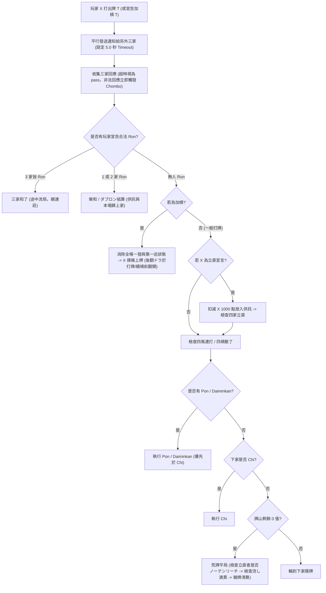

# 日本麻將 Server 與 Client 系統設計文件 (Design Document)

## 1. 系統總覽 (System Overview)

本專案實作一個符合天鳳（Tenhou）四人東南戰規則的日本麻將 Server，以及用於驗證 Server 功能的簡易 Client。
Server 負責啟動並管理 4 個獨立的 Client 子行程（Subprocess），透過標準輸入/輸出管道（`stdin`/`stdout` JSON Lines）進行非同步 IPC 溝通，並在行程啟動時強制設定計算資源上限（CPU Core Affinity / Quota 與 Memory Hard Limit）。

### 核心設計目標
- **非同步平行互動 (`asyncio`)**：使用 Python `asyncio` 管理 4 個 Client 子行程的 I/O 與 5 秒計時器，確保打牌與加槓後的 5 秒反應視窗能對另外三家**平行詢問**，不因詢問順序或有無合法動作而洩漏手牌資訊（防範 Timing / Side-channel 洩漏）。
- **嚴格合法性驗證與錯和（チョンボ）裁決**：Server 為唯一真相來源（Single Source of Truth），所有 Client 回傳的動作皆經過完整規則驗證；任何非法指令、格式錯誤、非預期動作皆視同錯和（Chombo）並依規定罰分與重賽該局。
- **完整實作 `tenhou-rules.txt` 規則**：涵蓋天鳳段位戰四人打完整規則（含搶槓、一發消滅時機、槓寶牌即乘/後翻、パオ責任拂、西入サドンデス、途中流局、流し満貫、振聴與立直後暗槓限制等）。
- **標準 MPSZ 牌譜記錄**：完整記錄整場半莊的配牌、摸打、副露、立直、寶牌與點數變動。

---

## 2. 系統架構與模組劃分 (Architecture & Modules)

專案目錄結構規劃如下：

```text
/usr/local/google/home/phoenixshen/temp/mj/
├── DESIGN.md                 # 本設計文件
├── config.json               # 伺服器與規則設定檔 (目前設定 timeout，預留規則與地方役擴充結構)
├── server/
│   ├── __init__.py
│   ├── config.py             # 設定檔載入器與結構化 Dataclass (ServerConfig / RuleConfig / LocalYakuConfig)
│   ├── main.py               # CLI 進入點與參數解析 (--config、CPU/Mem 限制、Client 指令、Seed、牌譜輸出路徑)
│   ├── ipc.py                # 子行程管理、資源限制 (rlimit/affinity/cgroup)、JSONL 非同步收發與可配置 Timeout
│   ├── tile.py               # 136 張實體牌與 34 種牌型轉換、MPSZ 編解碼 (含赤ドラ 0m/0p/0s)
│   ├── wall.py               # 洗牌、骰子決定起家與開門位置、配牌、王牌 (嶺上牌、表裏ドラ、カンドラ)
│   ├── hand.py               # 手牌狀態、副露 (Chi/Pon/Ankan/Kakan/Daiminkan)、喰い替え檢查、聽牌與向聽數計算
│   ├── agari.py              # 和牌判定、面子拆解、符數計算、可插拔役種判定 (含地方役擴充架構)、點數與包牌計算
│   ├── round_engine.py       # 單局狀態機 (摸牌、打牌、搶槓、平行鳴牌視窗、振聴追蹤、途中流局、荒牌平局、錯和)
│   ├── match_engine.py       # 半莊狀態機 (東1~南4、西入サドンデス、飛び終了、オーラス和了/聴牌止め、Uma/Oka 結算)
│   └── paifu.py              # MPSZ 牌譜記錄器與 JSON 匯出
├── client/
│   └── simple_client.py      # 驗證用簡易 Client (支援合法摸切、基本立直/和牌/鳴牌回應與測試模式)
└── tests/
    ├── test_tile_mpsz.py     # MPSZ 與牌型轉換單元測試
    ├── test_agari_yaku.py    # 役種、符數、點數計算單元測試
    ├── test_rules_edge.py    # 搶槓、振聴、喰い替え、立直暗槓、サドンデス、錯和等規則測試
    └── test_integration.py   # Server + 4 Clients 完整半莊整合測試
```

### 2.1 設定檔設計 (`config.json` 與 `server/config.py`)

Server 啟動時透過 `--config config.json` 載入設定檔。目前預設僅需設定 `timeout_sec`，同時在 `ServerConfig` 資料結構與 `agari.py` 役種判定器中預留 `rules` 與 `local_yaku` 擴充欄位，方便未來直接透過設定檔切換規則或啟用地方役（如人和、三連刻、一色三順、八連莊等）：

```json
{
  "timeout_sec": 5.0,
  "rules": {
    "kuitan": true,
    "aka_dora": true,
    "ranking_mode": "normal"
  },
  "local_yaku": {}
}
```
- **目前生效欄位**：
  - `timeout_sec`（預設 `5.0` 秒，控制自家摸牌/副露後打牌思考時間上限，以及他家打牌/加槓後鳴牌與搶槓平行等待時間上限）。
  - `rules.ranking_mode`：控制半莊結束時的最終排名方式，支援：
    - `"normal"`（預設）：標準天鳳得點與排名（依原始點數及起家風順決定 1~4 名，得點保留小數點後一位）。
    - `"plus_minus_zero"`（或 `"正負0"`）：**正負0 模式**。對局中的所有麻將規則、連莊與結束條件完全不變；唯半莊結束計算完各家含 オカ/ウマ 的得點後，先對各家得點進行**五捨六入**取整數（小數點後 `.1`~`.5` 往 `0` 捨去、`.6`~`.9` 往遠離 `0` 進位），再依照 `abs(五捨六入後的得點)` 由小到大排序決定名次（越接近 `0` 名次越前面，若 `abs` 值相同則**允許同名並列**，如第 1 名並列時下一名為第 3 名）。
- **未來擴充架構**：
  - `RuleConfig`：將 `kuitan`、`aka_dora`、`ranking_mode`、起算點/返還點、Uma、是否開啟途中流局/西入等參數封裝於 `RuleConfig` 物件並傳遞給 `MatchEngine`、`RoundEngine` 與 `AgariCalculator`。
  - `LocalYakuConfig` 與可插拔役種表（Yaku Registry）：在 `agari.py` 中將役種判定設計為註冊表模式（標準役 + 根據 `config.local_yaku` 動態啟用的地方役 Evaluator），未來新增地方役時只需註冊判定函式並在 `config.json` 開啟對應鍵值即可，無須改動核心狀態機。

---

## 3. 行程管理與資源限制 (Process & Resource Limiting)

Server 透過 `asyncio.create_subprocess_exec` 啟動 4 個 Client 行程，每個行程透過獨立的 `stdin` (Server 寫、Client 讀) 與 `stdout` (Client 寫、Server 讀) 管道溝通，`stderr` 重導向至日誌以便除錯。

### 3.1 計算資源限制機制 (`server/ipc.py`)
在啟動每個 Client 子行程時，透過 `preexec_fn`（以及選配的 Linux cgroups v2）實施硬性資源限制：

1. **Memory Hard Limit (記憶體硬上限)**：
   - 使用 `resource.setrlimit(resource.RLIMIT_AS, (mem_limit_bytes, mem_limit_bytes))` 限制虛擬記憶體空間上限（預設例如 `256 MB`，可由 CLI `--client-memory-mb` 調整）。
   - 若環境支援使用者層級 cgroup v2 (`systemd-run --user --scope -p MemoryMax=... -p MemorySwapMax=0`)，亦可選配啟用實體 RSS 硬上限。
2. **CPU Limit (CPU 數量限制)**：
   - 使用 `os.sched_setaffinity(0, assigned_cpus)` 將每個 Client 綁定至指定數量的 CPU 核（預設每個 Client 限制使用 `1` 個邏輯核心，可由 `--client-cpus` 設定核心數或分配策略）。
   - 搭配 `resource.setrlimit(resource.RLIMIT_CPU, ...)` 防止無限迴圈耗盡整場 CPU 時間。

### 3.2 異常與超時處理
- **思考時間限制 (5.0 秒)**：
  - 使用 `asyncio.wait_for(..., timeout=5.0)` 監控每次請求。
  - **摸牌後／副露後打牌超時**：Server 忽略該 Client 過期回應，自動執行：
    - 若為摸牌回合：自動**ツモ切り**（打出剛摸進的那張牌）。
    - 若為副露（吃/碰）後打牌超時：自動打出純手牌中最右側且不違反「喰い替え」的合法牌。
  - **他家打牌／加槓後的 5 秒反應視窗超時**：視為該家選擇 `pass`（不鳴牌／不和牌）。
- **非法回應 / 崩潰處理**：
  - 若 Client 在其應回應的視窗內傳回：
    1. 非法 JSON 格式或未知的 `action` 類型；
    2. 手牌中不存在的打牌、違反「喰い替え」的打牌、立直後非法打牌（非摸切且非合法暗槓）；
    3. 不滿足公開條件的立直（非門前清、點數 `< 1000`、牌山剩餘 `< 4` 張）、不合法的暗槓、加槓、吃、碰、大明槓、九種九牌；
    4. 無役、未聽牌或振聴狀態下宣告「榮和 (Ron)」或「自摸 (Tsumo)」；
    5. **ノーテンリーチ（未聽牌立直）於荒牌平局（流局）開牌檢查時被抓出**（立直宣告當下不檢查是否聽牌，若中途有人和牌或途中流局則不公開手牌不罰；唯打至荒牌平局必須公開手牌時，若立直者為ノーテン則判錯和）；
    6. 行程無預警關閉管道 (EOF / Crash，例如觸發 Memory Limit OOM)；
  - **一律立即判定該 Client 錯和（チョンボ）**。若該 Client 行程已終止，Server 在下一局開始前可自動重啟該 Client 行程以繼續完成半莊（或若連續崩潰則依設定處理）。

---

## 4. 牌面表示法与 MPSZ 規範 (Tile Representation & MPSZ)

### 4.1 外部通訊與牌譜表示 (MPSZ 單張與牌串)
遵循 `task.md` 規範：
- **萬子 (Manzu)**：`1m` ~ `9m`，赤五萬為 `0m`
- **筒子 (Pinzu)**：`1p` ~ `9p`，赤五筒為 `0p`
- **索子 (Souzu)**：`1s` ~ `9s`，赤五索為 `0s`
- **字牌 (Jihai)**：
  - `1z` = 東, `2z` = 南, `3z` = 西, `4z` = 北
  - `5z` = 白, `6z` = 發, `7z` = 中

#### 兩種顯示格式
1. **單張牌 Token（用於 IPC 動作與單步事件）**：固定 2 字元字串，如 `"0m"`, `"5m"`, `"1z"`。
2. **緊湊 MPSZ 牌串（用於牌譜配牌與最終手牌記錄）**：同花色數字合併並按 `m -> p -> s -> z` 排序，例如 `"123m406p789s1122z"`（其中 `0` 代表赤五，排序時置於 `4` 與 `5` 之間）。

### 4.2 內部 136 張實體牌編碼
- 內部以 `tile_id: int` (`0..135`) 唯一識別每張實體牌：
  - `kind34 = tile_id // 4` (`0..8`: 1m-9m, `9..17`: 1p-9p, `18..26`: 1s-9s, `27..33`: 1z-7z)。
  - 赤ドラ固定為五萬 (`tile_id == 16`)、五筒 (`tile_id == 52`)、五索 (`tile_id == 88`)，各 1 枚。
- 當 Client 指定打牌或副露時（例如手上有 `"0m"` 與 `"5m"`），以 `"0m"` 與 `"5m"` 明確區分是否打出或使用赤寶牌。

---

## 5. IPC 通訊協定設計 (JSON Lines over Stdio)

所有訊息皆為單行 JSON（以 `\n` 結尾）。為防止舊回合遲到的封包干擾新回合，每個需要回應的事件皆帶有單調遞增的 `seq` 序號，Client 回傳時需帶回相同的 `seq`（或 Server 在進入下一狀態時清空過期 `seq`）。

### 5.1 Server -> Client 訊息類型

1. **遊戲開始 (`match_start`)**
   ```json
   {
     "type": "match_start",
     "seat": 0,
     "dealer_first_seat": 2,
     "dice_seating": [3, 4],
     "rules": {"kuitan": true, "aka_dora": true, "start_points": 25000, "return_points": 30000}
   }
   ```
   - `seat`: 隨機分配給該 Client 的座位編號 (`0..3`)。
   - `dealer_first_seat`: 東一局起家的座位編號（由 `dice_seating` 決定）。

2. **單局開始 (`round_start`)**
   ```json
   {
     "type": "round_start",
     "round_wind": "E",
     "round_number": 1,
     "honba": 0,
     "kyoutaku": 0,
     "dealer_seat": 2,
     "seat_wind": "W",
     "dice_wall": [5, 6],
     "wall_break_seat": 0,
     "wall_break_stack": 11,
     "dora_indicators": ["3p"],
     "points": [25000, 25000, 25000, 25000],
     "hand": ["1m", "2m", "3m", "0p", "6p", "7p", "2s", "3s", "4s", "1z", "1z", "7z", "7z"]
   }
   ```

3. **輪到自己摸牌與行動 (`turn_tsumo`)** —— **限時 5 秒回應**
   ```json
   {
     "type": "turn_tsumo",
     "seq": 15,
     "tile": "4p",
     "is_rinshan": false,
     "remaining_tiles": 69,
     "dora_indicators": ["3p"]
   }
   ```
   *(同時向另外三家廣播 `{"type": "player_tsumo", "seat": 2, "is_rinshan": false, "remaining_tiles": 69}`，不包含牌面)*

4. **副露後輪到自己打牌 (`turn_After_call`)** —— **限時 5 秒回應**
   ```json
   {
     "type": "turn_after_call",
     "seq": 18,
     "forbidden_discards": ["4m", "7m"]
   }
   ```
   - `forbidden_discards`: 因「喰い替えなし」規則禁止於本巡打出的牌面提示（Client 若仍打出則判 Chombo）。

5. **他家打牌通知與鳴牌詢問 (`discard_notify`)** —— **對另外三家平行發送，限時 5 秒回應**
   ```json
   {
     "type": "discard_notify",
     "seq": 16,
     "seat": 2,
     "tile": "7z",
     "is_tsumogiri": false,
     "is_riichi": false,
     "remaining_tiles": 69
   }
   ```
   - 打牌者本人收到確認通知（不需回應）；**另外三家皆收到此訊息並必須在 5 秒內回應**（如不動作則回 `{"seq": 16, "action": "pass"}`）。

6. **他家加槓通知與槍槓詢問 (`kakan_notify`)** —— **對另外三家平行發送，限時 5 秒回應**
   ```json
   {
     "type": "kakan_notify",
     "seq": 22,
     "seat": 1,
     "tile": "5s"
   }
   ```
   - 另外三家在 5 秒內回應 `{"seq": 22, "action": "ron"}`（搶槓和）或 `{"seq": 22, "action": "pass"}`。

7. **公開事件廣播 (`call_notify`, `dora_notify`, `riichi_accepted`)**
   - 當有人成功執行 `chi` / `pon` / `daiminkan` / `ankan` 時，向全體廣播 `call_notify`（含副露者座位、種類、組成牌、來源座位）。
   - 當暗槓即乘或明槓/加槓後翻開新寶牌指示牌時，向全體廣播 `dora_notify`。
   - 當立直宣言牌未被榮和、成功扣減 1000 點供託時，廣播 `riichi_accepted`。

8. **單局結束 (`round_end`) 與 半莊結束 (`match_end`)**
   - `round_end`: 包含結局類型（`tsumo`, `ron`, `chombo`, `ryuukyoku_exhaustive`, `ryuukyoku_nagashi_mangan`, `ryuukyoku_abortive`）、和牌明細（飜、符、役種列表、裏ドラ、包牌）、各家點數增減與最新總分。
   - `match_end`: 包含最終原始點數、名次、Uma/Oka 加計後的最終得分（pt）與牌譜檔案路徑。

### 5.2 Client -> Server 回應格式

#### A. 自己回合 (`turn_tsumo` / `turn_after_call`) 的合法回應：
- **打牌**：`{"seq": 15, "action": "discard", "tile": "7z"}`
- **立直並打牌**：`{"seq": 15, "action": "riichi", "tile": "7z"}`
- **自摸和牌**：`{"seq": 15, "action": "tsumo"}`
- **暗槓**：`{"seq": 15, "action": "ankan", "tile": "1z"}`（若含赤五萬則傳 `"5m"` 或 `"0m"` 皆代表槓五萬四張）
- **加槓**：`{"seq": 15, "action": "kakan", "tile": "0p"}`
- **九種九牌流局**：`{"seq": 15, "action": "kyuushu"}`

#### B. 他家打牌或加槓 (`discard_notify` / `kakan_notify`) 的合法回應：
- **略過**：`{"seq": 16, "action": "pass"}`
- **榮和 / 搶槓**：`{"seq": 16, "action": "ron"}`
- **碰**：`{"seq": 16, "action": "pon", "tiles": ["0p", "5p"]}`（明確指定從手牌拿出的 2 張牌）
- **大明槓**：`{"seq": 16, "action": "daiminkan"}`
- **吃（僅限下家）**：`{"seq": 16, "action": "chi", "tiles": ["4m", "6m"]}`（明確指定從手牌拿出的 2 張牌）

---

## 6. 麻將規則與狀態機細節 (`tenhou-rules.txt` 完整對應)

### 6.1 開局、配牌與王牌
1. **隨機分配座位**：Server 啟動時將 4 個 Client 隨機洗牌分配至座位 `0, 1, 2, 3`。
2. **決定起家**：擲 2 顆六面骰 (`2d6`，點數和 `S1`)，從座位 `0` 逆時針數 `(S1 - 1) % 4` 為東一局起家（東家）。
3. **決定開門與配牌**：每局開始由親家擲 2 顆六面骰 (`2d6`，點數和 `S2`)，從親家逆時針數 `(dealer + S2 - 1) % 4` 找到開門牌山，由右向左數 `S2` 幢（每幢上下 2 張牌）切開。切口右側的 7 幢（14 張）構成**王牌**（含嶺上牌 4 張、表ドラ指示牌 5 張、裏ドラ指示牌 5 張），切口左側順時針依序配牌，最後留 70 張於活壁（山牌）供摸牌。

### 6.2 平行鳴牌與搶槓裁決流程


### 6.3 關鍵天鳳規則實作要點

| 規則項目 | 實作細節 |
| :--- | :--- |
| **喰い替えなし** | 吃或碰後，該巡不得打出與所鳴之牌同種的牌（現物喰い替え），亦不得打出與吃牌兩張手牌構成兩面搭子另一端的筋牌（筋喰い替え）。例如以 `5m6m` 吃 `4m`，該巡禁打 `4m` 與 `7m`；以 `4m6m` 吃 `5m` 或碰 `5m`，該巡禁打 `5m`（含 `0m`）。 |
| **カンドラ與カン裏** | **暗槓**宣告時立即翻開新ドラ指示牌（即乗り）；**大明槓／加槓**則在摸進嶺上牌後、打出牌之前（或連續槓的第二次嶺上摸牌直前）翻開新ドラ指示牌（後めくり）。故加槓被搶槓時不翻新ドラ。 |
| **一發與純正巡消し** | 吃、碰、大明槓、暗槓宣告時立即消除全場一發與天地和/九種/四風之第一巡判定。**加槓**則在「發聲並詢問他家是否搶槓後、摸嶺上牌之前」才消除一發；因此**第一次加槓被搶槓時，立直者的一發仍然有效（一發與搶槓複合）**，但若無人搶槓而摸嶺上牌後再連續加槓第二次，第二次加槓時一發已消滅。一發與嶺上開花不複合。 |
| **搶槓 (Chankan)** | 僅限他家**加槓**時可搶槓榮和（1 飜，可僅憑搶槓 1 飜和牌）。他家**暗槓**時，即使是國士無雙亦**不可**搶暗槓（`※他家が暗槓した牌では国士無双はあがれない`）。 |
| **振聴 (Furiten)** | 1. **捨牌振聴**：自己河中出現過的牌（含被他家鳴走的牌，但不含加槓添牌）在自己當前聽牌範圍內。<br>2. **同巡振聴**：他家打出的可榮和牌（或加槓可搶槓牌）選擇 `pass`（含因無役而無法榮和之牌），直到自己下一次摸牌或自己打牌前不得榮和（逆巡副露不解除，唯有自己打牌時才解除）。<br>3. **立直後振聴**：立直後對任何可構成和牌型的牌（含加槓牌）放過，該局永久振聴。<br>※ 國士無雙 13 面聽時，只要 13 種幺九牌任一張在河中即為振聴。 |
| **立直與ノーテンリーチ** | 宣告立直時僅檢查公開條件（門前清、點數 `>= 1000`、牌山剩餘 `>= 4` 張），**不檢查手牌是否聽牌**。若中途有人和牌或發生途中流局，立直者不需公開手牌故不罰；若打至**荒牌平局（流局）**，所有立直者必須公開手牌，此時若發現未聽牌（ノーテンリーチ，含待牌 4 枚全在純手牌中之假聽牌），立即判定**錯和（チョンボ）**。 |
| **立直後暗槓** | 立直後僅允許在「摸進第 4 張牌的當巡」暗槓，且滿足：<br>1. 該玩家本身必須處於有效聽牌狀態（若為ノーテンリーチ狀態下宣告暗槓，因無法滿足待牌不變條件，直接判チョンボ）；<br>2. 不可包含手牌原有已湊齊的 4 張（必須暗槓剛摸進的那種牌）；<br>3. **送り槓不可**；<br>4. **聽牌的待牌集合（待ち）完全不變**（牌姿分解或役種增減不問，但槓完後構成面子分解中該暗槓不可被拆作順子的一部分，即所有可能和牌分解中該 4 張牌皆必須作為刻子/槓子存在）。 |
| **形式聴牌與第5枚待** | 允許無役形式聽牌；允許單騎或待牌已見 4 枚的形式聽牌，**但若 4 枚同種牌全數在自己的純手牌（不含副露）中，則不承認為聽牌**（例如純手牌持 4 張 `1z` 再單騎 `1z` 不算聽牌）。 |
| **途中流局** | 1. **九種九牌**：第一巡無任何鳴牌/暗槓時，摸牌後純手牌含 9 種以上幺九牌可宣告。<br>2. **四風連打**：第一巡無任何鳴牌/暗槓，四家皆打出同一種風牌。<br>3. **四家立直**：四家皆成功宣告立直（第 4 家立直宣言牌未被榮和）。<br>4. **四槓散了**：2 家以上合計開滿 4 槓後，第 4 槓者的打牌未被榮和（且未直接自摸）；若 1 人獨開 4 槓則繼續進行，且第 5 槓全場禁開。<br>5. **三家和了**：對同一張捨牌或加槓牌，三家同時宣告合法榮和。<br>※ 所有途中流局皆為**親家連莊**，本場數 +1。 |
| **流し満貫** | 荒牌平局時，若某玩家河中全為幺九牌，且**自己河中的牌未曾被他家鳴走**（自己鳴過他家的牌仍成立），則代替全場聽牌清算，直接以滿貫自摸點數結算（親家 4000 all、子家 2000/4000，不計本場與供託），連莊判定仍依親家是否聽牌決定。 |
| **包牌 (パオ)** | 僅限**大三元**（副露第 3 組三元牌刻/槓）與**大四喜**（副露第 4 組風牌刻/槓）有包牌（四槓子無包牌）。和牌時針對所有複合役滿總點數（不含一般役）：自摸由包牌者全額支付（含本場積み棒）；他家放銃榮和則由放銃者與包牌者折半支付，**積み棒由包牌者全額負擔**。 |
| **錯和 (チョンボ)** | 該局立即中止：<br>- **親家錯和**：支付子家 3 人各 `4,000` 點（共 `12,000` 點）。<br>- **子家錯和**：支付親家 `4,000` 點、另外兩名子家各 `2,000` 點（共 `8,000` 點）。<br>- 該局宣告的立直棒退還給原立直者（先前累積的供託保留）。<br>- **本場數不增加，親家不變（同局重賽）**。<br>- 若罰分後導致錯和者點數 `< 0`，觸發飛び終了。 |
| **半莊結束與西入** | 1. **飛び終了**：任一玩家局結算後點數 `< 0` 立即結束（`0` 點繼續）。<br>2. **南4局（オーラス）結束判定**：<br>   - 若親家和牌或聽牌且親家為全場第一名（同點以東1局起家風順優先）且點數 `>= 30,000`（不含未收供託）：**自動和了止め／聴牌止め**，半莊結束。<br>   - 若親家連莊但未達上述條件：進入南4局下一本場。<br>   - 若親家流莊（子家和牌或親家ノーテン）：若場上有人 `>= 30,000` 則半莊結束；若全體皆 `< 30,000` 則進入**西入（西1局～西4局）サドンデス**。<br>3. **西入サドンデス**：任一局結束時只要有人 `>= 30,000` 且無親家連莊（或親家已是 `>= 30,000` 第一名）即結束；最長打到**西4局**結束（無連莊時即便無人滿 30,000 亦強制結束）。 |
| **最終分數與排名** | 1. 剩餘供託歸原始點數 1 位所有。<br>2. 依原始點數（同點時依東 1 局座次 東 > 南 > 西 > 北）決定原始順位 `1~4`，扣除 30,000 原點後除以 1000，加上オカ（1 位 +20pt）與ウマ（1位 +20, 2位 +10, 3位 -10, 4位 -20），即總加成 `1位 +40, 2位 +10, 3位 -10, 4位 -20`。<br>3. **`ranking_mode = "normal"`（預設）**：直接以原始順位作為最終名次 (`1~4`)，`final_pt` 保留至小數點後 1 位。<br>4. **`ranking_mode = "plus_minus_zero"` / `"正負0"`（正負0模式）**：各家得點先經**五捨六入**取整數（`final_pt`），再依 `abs(五捨六入後的得點)` 由小至大排名（越接近 `0` 名次越前），`abs` 相同者**允許同名並列**（例如兩家同為 `abs == 2` 並列第 1 名，下一家為第 3 名）。 |

---

## 7. 和牌計算引擎 (`server/agari.py`)

### 7.1 面子分解與高點法
- 對 14 張牌（純手牌 + 副露）列舉所有合法和牌分解：
  1. **國士無雙型**（13 種幺九牌各 1 + 任一幺九牌成對；若純手牌 13 張恰為 13 種幺九牌且和第 14 張則為國士無雙十三面，同為單倍役滿，但注意 13 面振聴）。
  2. **七對子型**（門前 7 組不同種對子，固定 25 符 2 飜，不加自摸符；可複合字一色）。
  3. **標準 4 面子 1 雀頭型**（遞迴拆解純手牌中的順子與刻子）。
- 針對每一種拆解計算對應的**役種（Yaku）**與**符數（Fu）**，依「高點法」選取**最終得點最高**（若得點相同則取飜數較高、再取符數較高）的組合。

### 7.2 符數計算規則 (`tenhou-rules.txt`)
- **副底**：20 符。
- **門前加符**：門前榮和 +10 符。
- **自摸加符**：自摸 +2 符（**平和自摸除外，固定 20 符 2 飜**；**嶺上開花自摸亦加 2 符**）。
- **雀頭符**：場風、自風、三元牌各 +2 符；**連風牌（場風＝自風）為 +4 符**。
- **面子符**：
  - 中張牌（2~8）：明刻 +2、暗刻 +4、明槓 +8、暗槓 +16。
  - 幺九字牌（1, 9, 字）：明刻 +4、暗刻 +8、明槓 +16、暗槓 +32。
  - ※ 榮和完成之刻子算**明刻**，榮和完成之順子算**暗順**。
- **聽牌型符**：單騎、嵌張、邊張各 +2 符（若可解釋為兩面聽則看哪種拆解總點數高）。
- **進位與特例**：
  - 七對子固定 **25 符**。
  - 平和自摸固定 **20 符**。
  - 副露後若計算為 20 符（如喰い平和型榮和），強制補為 **30 符**。
  - 其餘總符數無條件進位至十位數（如 32 符 -> 40 符）。

### 7.3 點數計算公式
- 基本點 $B = \text{符} \times 2^{\text{飜} + 2}$：
  - 若 $B \ge 2000$（例如 5 飜、4 飜 40 符、3 飜 70 符）則為滿貫 $B = 2000$。
  - 6~7 飜跳滿 $B = 3000$；8~10 飜倍滿 $B = 4000$；11~12 飜三倍滿 $B = 6000$；13 飜以上數え役満 $B = 8000$。
  - 役滿每 1 倍 $B = 8000$（役滿可複合，如字一色＋大四喜＝2 倍役滿 $B = 16000$；四暗刻單騎、國士十三面、純正九蓮寶燈皆為單倍役滿）。
- 支付額（每家支付額無條件進位至百位數）：
  - **親家自摸**：子家每人支付 $\lceil 2B / 100 \rceil \times 100 + 100 \times \text{本場}$。
  - **親家榮和**：放銃者支付 $\lceil 6B / 100 \rceil \times 100 + 300 \times \text{本場}$。
  - **子家自摸**：親家支付 $\lceil 2B / 100 \rceil \times 100 + 100 \times \text{本場}$，子家每人支付 $\lceil B / 100 \rceil \times 100 + 100 \times \text{本場}$。
  - **子家榮和**：放銃者支付 $\lceil 4B / 100 \rceil \times 100 + 300 \times \text{本場}$。

---

## 8. 牌譜格式設計 (`server/paifu.py`)

牌譜以結構化 JSON 檔案儲存（預設輸出至 `paifu.json`），所有牌面與手牌皆採用 **MPSZ 表示法**：

```json
{
  "match_id": "20261017-172000",
  "seed": 42,
  "seating": [
    {"seat": 0, "client_cmd": "python3 client/simple_client.py", "initial_east_order": 2},
    {"seat": 1, "client_cmd": "python3 client/simple_client.py", "initial_east_order": 3},
    {"seat": 2, "client_cmd": "python3 client/simple_client.py", "initial_east_order": 0},
    {"seat": 3, "client_cmd": "python3 client/simple_client.py", "initial_east_order": 1}
  ],
  "dice_seating": [3, 4],
  "rounds": [
    {
      "round": "E1",
      "honba": 0,
      "kyoutaku": 0,
      "dealer": 2,
      "dice_wall": [5, 6],
      "dora_indicators": ["3p"],
      "ura_dora_indicators": ["1s"],
      "initial_hands_mpsz": [
        "123m406p789s1122z",
        "234m556p123s3344z",
        "119m123p456s5567z",
        "345m789p230s1234z"
      ],
      "events": [
        {"type": "draw", "seat": 2, "tile": "7z"},
        {"type": "discard", "seat": 2, "tile": "7z", "tsumogiri": true, "riichi": false},
        {"type": "pon", "seat": 0, "from_seat": 2, "called_tile": "7z", "hand_tiles": ["7z", "7z"], "mpsz": "777z"},
        {"type": "discard", "seat": 0, "tile": "1m", "tsumogiri": false, "riichi": false}
      ],
      "result": {
        "type": "tsumo",
        "winner": 0,
        "hand_mpsz": "23m406p789s11z",
        "melds_mpsz": ["777z"],
        "winning_tile": "1m",
        "han": 2,
        "fu": 30,
        "yaku": ["役牌:中", "赤ドラ"],
        "score_deltas": [2000, -500, -1000, -500],
        "scores_after": [27000, 24500, 24000, 24500]
      }
    }
  ],
  "final_results": [
    {"rank": 1, "seat": 0, "raw_score": 35400, "final_pt": 45.4},
    {"rank": 2, "seat": 2, "raw_score": 28200, "final_pt": 8.2},
    {"rank": 3, "seat": 1, "raw_score": 21000, "final_pt": -19.0},
    {"rank": 4, "seat": 3, "raw_score": 15400, "final_pt": -34.6}
  ]
}
```

---

## 9. 驗證用 Client 設計 (`client/simple_client.py`)

驗證用 Client 為獨立執行的 Python 程式，透過 `sys.stdin` 讀取 JSON 行、透過 `sys.stdout` 輸出回應並 `flush()`：
1. **預設策略（合法穩定對局模式）**：
   - 收到 `turn_tsumo` 時：
     - 若可自摸和牌（有役），立即宣告 `tsumo`；
     - 若門前聽牌且分數 `>= 1000` 且山牌 `>= 4`，宣告 `riichi`；
     - 否則選擇手牌中孤立字牌或邊張打出（或摸切），確保所有動作 100% 合法且在數毫秒內回應。
   - 收到 `discard_notify` / `kakan_notify` 時：
     - 若可合法榮和（有役且非振聴），宣告 `ron`；
     - 若持有役牌對子且他家打出該役牌，可選擇 `pon`（吃/碰後自動避開 `forbidden_discards` 打牌）；
     - 其餘情況立即回應 `pass`。
2. **測試與驗證模式（透過環境變數或命令列參數切換）**：
   - `--mode timeout`：故意 sleep 超過 5 秒，驗證 Server 自動ツモ切り與鳴牌超時略過機制。
   - `--mode chombo`：故意打出不存在的手牌或非法榮和，驗證 Server 錯和罰分（親 12000 / 子 8000）與重賽機制。
   - `--mode mem-hog`：故意分配超過上限的記憶體，驗證 Server 的 Memory Hard Limit 保護機制。
